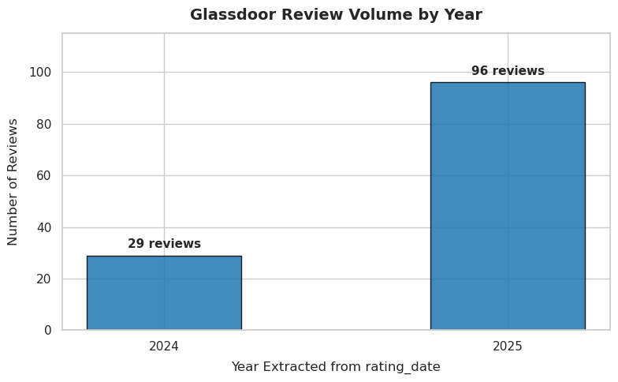

# Amazon Glassdoor Review Analysis

This project analyzes employee reviews of Amazon fulfillment centers using
ratings, review text, theme classification, and sentiment analysis.

## Dataset overview

The current raw Glassdoor dataset contains **127 reviews**:

- **29 reviews from 2024**
- **98 reviews from 2025**

The text analysis examines four review fields:

- `review_pros`
- `review_cons`
- `summary`
- `advice_to_management`

## Rating findings

The overall rating distribution is relatively positive, with most rated reviews
falling between 3 and 5 stars. However, the detailed categories show more
mixed employee experiences:

- Compensation and benefits are a relative strength.
- Senior leadership, work-life balance, culture values, and diversity and
  inclusion show substantial low or unrated responses.
- Career opportunities and work-life balance are less consistently positive
  than the overall rating suggests.

)

## Review-theme findings

### Cons

The most recurring concerns in `review_cons` are:

- Schedule and flexibility
- Physical demands and fatigue
- Workplace culture and relationships
- Management and leadership

These findings suggest that positive overall ratings do not fully represent
the day-to-day experience of employees working in physically demanding,
high-pressure environments.

### Pros

The strongest positive themes in `review_pros` are:

- Pay and benefits
- Schedule and flexibility
- Workplace culture and coworkers

The contrast between pros and cons is especially clear for schedule
flexibility. It appears in both categories, indicating that scheduling
experiences vary substantially by site, role, shift, or employee situation
rather than being uniformly positive or negative.

### Summary

Across the rating and text results, Amazon appears to provide comparatively
strong compensation and benefits while presenting recurring challenges related
to physical workload, management, leadership, and workplace culture.

Schedule flexibility should be interpreted as context-dependent: it appears
among both positive and negative experiences, with the current theme summary
showing approximately **26% in pros and 26% in cons**.

### Advice to management

The `advice_to_management` field contains **37 nonblank reviews**. The most
common recommendations focus on:

- Improving management support and communication
- Treating employees fairly and respectfully
- Addressing workplace culture and interpersonal issues
- Providing more consistent leadership
- Improving scheduling and workload conditions

## Focused workplace issues

The project also includes focused theme detection for:

- `workplace_politics`: favoritism, bias, nepotism, partiality, unfair
  treatment, and retaliation
- `bathroom_access`: restricted or denied bathroom breaks, bathroom monitoring,
  and inadequate restroom access

These focused themes are scanned across all four review text columns to show
which fields contain each issue.

## Analysis pipeline

The repository includes:

- Rule-based keyword theme matching
- Word and bigram frequency analysis
- Zero-shot multilingual NLI classification
- BERTopic topic discovery using sentence embeddings, UMAP, HDBSCAN, and
  c-TF-IDF
- Sentiment and rating analysis

BERTopic is used for discovering emerging topics, while the configured theme
vocabulary provides interpretable categories for targeted analysis. Sentiment
analysis across all four text columns is planned as the next stage of the
project.

## Repository structure

- [data/](data/) — raw and processed datasets
- [src/text_engine/](src/text_engine/) — cleaning, themes, plots, and models
- [src/notebook/glassdoor.ipynb](src/notebook/glassdoor.ipynb) — main analysis notebook
- [docs/](docs/) — supporting analysis and figures
- [requirements.txt](requirements.txt) — Python dependencies

## Responsible use

The dataset is based on publicly available Glassdoor and YouTube sources. It
represents reported employee experiences and should not be treated as a
complete or unbiased measurement of all Amazon workplaces.